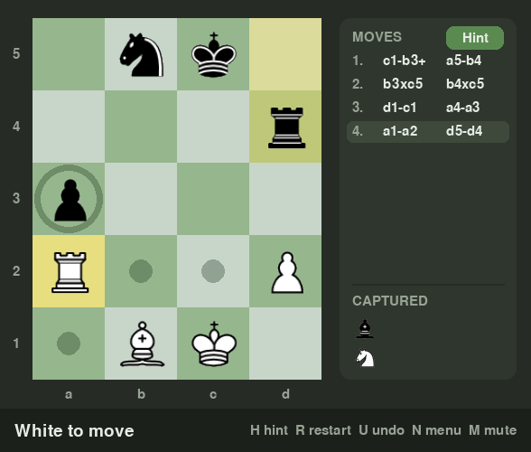

# Micro Chess



Chess on a 4×5 board, with a pygame interface and a computer opponent.

## What is Micro Chess?

Micro Chess is a small chess variant invented by Glimne in 1997. The board is 4 squares wide and
5 high, and each side has only five pieces: a king, a rook, a bishop, a knight and a pawn. Games
are short and sharp, since a single mistake can decide them.

### Starting position

```
    a   b   c   d
  +---+---+---+---+
5 | k | n | b | r |
  +---+---+---+---+
4 | p |   |   |   |
  +---+---+---+---+
3 |   |   |   |   |
  +---+---+---+---+
2 |   |   |   | P |
  +---+---+---+---+
1 | R | B | N | K |
  +---+---+---+---+
```

Uppercase letters are White, lowercase are Black: **K** king, **R** rook, **B** bishop, **N** knight,
**P** pawn. White moves first.

### Rules

The pieces move as in ordinary chess, with these differences:

- **Pawns** move one square at a time (there is no two-square first move, so no en passant).
- **Promotion:** there is no queen, so a pawn that reaches the far rank becomes a rook, bishop or knight.
- **Castling:** the king moves two squares toward its rook and the rook jumps to the square the king
  crossed. For White that is king d1→b1 and rook a1→c1; for Black, king a5→c5 and rook d5→b5. It's
  allowed only if neither the king nor that rook has moved, the squares between them are empty, and
  the king isn't in check and doesn't pass through or land on an attacked square.
- **Draws:** stalemate, threefold repetition, or insufficient material: neither side has the pieces
  to checkmate. That's the two kings alone, a king and knight against a king, or kings with only
  bishops that all stand on squares of the same color. None of these can ever reach checkmate on
  this board.

## Game modes

Besides the classic 4×5 board, there are three more small boards to choose from on the start menu.
They follow the rules above, except that there's no castling. The starting positions were picked
by having the computer play hundreds of games on candidate setups and keeping ones where White
and Black win about equally often.

**Tiny** (4×4): the quickest games. The pawns meet on the first move.

```
    a   b   c   d
  +---+---+---+---+
4 | k | b | r | n |
  +---+---+---+---+
3 |   | p |   |   |
  +---+---+---+---+
2 |   |   | P |   |
  +---+---+---+---+
1 | N | R | B | K |
  +---+---+---+---+
```

**Donut** (5×5) and **Pillars** (5×5) have holes in the board, marked `#`. No piece can stand on a
hole, and rooks, bishops and pawns can't move across one, but knights jump over holes as usual.
Holes also block check, and a hole next to a king takes away an escape square.

```
Donut                              Pillars
    a   b   c   d   e                  a   b   c   d   e
  +---+---+---+---+---+              +---+---+---+---+---+
5 | r | n |   | b | k |            5 | k |   | n | r | b |
  +---+---+---+---+---+              +---+---+---+---+---+
4 | p | p |   |   |   |            4 | p |   |   |   | p |
  +---+---+---+---+---+              +---+---+---+---+---+
3 |   |   | # |   |   |            3 |   | # |   | # |   |
  +---+---+---+---+---+              +---+---+---+---+---+
2 |   |   |   | P | P |            2 | P |   |   |   | P |
  +---+---+---+---+---+              +---+---+---+---+---+
1 | K | B |   | N | R |            1 | B | R | N |   | K |
  +---+---+---+---+---+              +---+---+---+---+---+
```

## Features

- A pygame interface: click or drag the pieces, with each piece's legal moves marked
- Four boards: the classic 4×5, a 4×4, and two 5×5 boards with holes in them
- Hints: press H (or the Hint button) and an arrow shows the best move the AI can find
- Play against the computer as White or Black (the board turns around when you play Black), at
  Easy, Medium or Hard, or play a friend on the same computer
- Highlights for the last move and for a king in check, plus a picker for pawn promotion
- A side panel with the move list and the captured pieces
- Sliding piece animations, and move and capture sounds generated in code (no sound files)
- A settings screen where you switch the extras on or off: sound, the legal-move dots, animations,
  the Hint button, board coordinates and the "Quit the game?" question. Your settings and your last
  choices on the start menu are remembered between launches
- An optional chess clock (off unless you choose one)
- An optional evaluation bar showing who is ahead, by the computer's reckoning
- Game review: step through a finished game, with mistakes marked and a better move shown for each
- Undo, restart, and a game-over screen with **Play again**
- The computer thinks in a background thread, so the window never freezes
- A terminal version that needs nothing but Python, with all four boards
- A pytest test suite, including GUI tests that run without opening a window

## Installing and running

You need Python 3 (developed with Python 3.13) and pygame 2.1 or newer.

```bash
git clone https://github.com/nikhilkumar1226/Mirco-Chess.git
cd Mirco-Chess
python3 -m pip install -r requirements.txt
python3 main.py
```

To keep the packages separate from the rest of your system, create a virtual environment first:

```bash
python3 -m venv .venv
source .venv/bin/activate        # on Windows: .venv\Scripts\activate
```

The terminal version doesn't need pygame:

```bash
python3 play_terminal.py
```

## Controls

On the start menu, choose the board, your opponent (**Computer** or **2 Players**), your color
and the difficulty, then click **Start game** or press Enter.

| Action | Control |
| --- | --- |
| Select a piece | Click it: dots mark the squares it can move to, rings mark captures |
| Move | Click one of the marked squares, or drag the piece there |
| Cancel a selection | Click anywhere else |
| Castle | Move the king two squares (d1→b1 for White, a5→c5 for Black) |
| Promote a pawn | Choose rook, bishop or knight in the picker |
| Hint | **H** or the **Hint** button: an arrow shows the best move (searched at Hard strength) |
| Undo | **U**: takes back your move and the computer's reply (one move in a 2-player game) |
| Restart | **R** |
| Back to the menu | **N** |
| Settings | **S**, the cog button above the move list, or **Settings** on the start menu |
| Sound on/off | **M** (or in Settings) |
| Review a finished game | **Review** on the game-over panel, **←**, or click a move in the list |
| Step through the review | **←** **→**, **Home** / **End**, or the buttons in the status bar; **Esc** to finish |
| Quit | **Esc** (once a game has started, it asks first: **Enter** quits, **Esc** keeps playing) |

The settings are saved in a small file, `.micro_chess.json`, in your home folder. Delete it to go
back to the defaults.

**Chess clock:** there's no clock unless you pick one in Settings: 1, 3, 5 or 10 minutes for each
player. The running clock is lit up above the move list and turns red in the last 10 seconds. If
your time runs out you lose, unless your opponent has only their king left, which makes it a draw.
The clock stops while the settings or the "Quit the game?" question are open, and choosing a
different clock during a game starts both clocks again.

**Evaluation bar:** switch it on in Settings for a bar between the board and the move list. White's
part grows from White's side of the board as White gets ahead. The number under it is the lead in
pawns (+1.2 means White is ahead by about a pawn, -0.5 Black by half a pawn), or +M2 / -M2 for a
forced mate in 2 moves. It comes from a 4-move-deep search after every move, the same as Medium.

**Game review:** when a game ends, click **Review** to step through it. The computer checks every
move with a short search, comparing the best score it can find before the move with the score
after it. A move that gave away 1.5 pawns or more is marked **?**, and 3 pawns or more **??**.
For a marked move, a green arrow shows the move that would have been better. You can switch review
off in Settings.

In the terminal version, type a move as two squares, such as `d2 d3`. To castle, type the king's
move (`d1 b1` or `a5 c5`). Type `quit` to leave.

## How the AI works

The computer uses **minimax search with alpha-beta pruning**. It tries every move, every reply to
it, every answer to that reply and so on, assuming both sides always pick their best option.
Alpha-beta pruning skips lines that can't change the final choice, which makes the search much
faster without changing its result.

**Difficulty is the search depth**, the number of moves (plies) it looks ahead:

| Level | Depth |
| --- | --- |
| Easy | 2 plies |
| Medium | 4 plies |
| Hard | 6 plies |

At the end of each line it scores the position (positive is good for White) by adding up:

- **Material:** pawn 100, knight and bishop 300, rook 500
- **Piece-square tables** for the 4×5 board: knights and bishops prefer the center, pawns gain value
  as they advance, and the king stays tucked in its corner while there are pieces around to attack
  it, then heads for the center in the endgame. On the other boards these tables are worked out
  from the board's shape, so squares next to a hole or an edge, where a piece reaches less, count
  for less
- **Mobility:** a small bonus for every square a knight, bishop or rook can move to
- **King safety:** a penalty for every enemy attack on the squares around the king

A few more details:

- Captures and promotions are searched first, which lets alpha-beta prune much more.
- A checkmate scores far above anything else, and a sooner mate scores higher, so it takes the
  quickest win and puts off a loss as long as it can.
- Draws by stalemate, repetition or insufficient material score 0.
- When several moves score exactly the same, it picks one of them at random.
- On Easy it picks at random from all the moves that score at most 300 (three pawns) below its best,
  so it sometimes gives away a knight or bishop and plays more varied games. It still always takes a
  checkmate in one when it has one.

Hard usually answers in well under a second.

## Running the tests

```bash
python3 -m pip install -r requirements-dev.txt
python3 -m pytest
```

The GUI and sound tests use SDL's dummy video and audio drivers, so no window opens and nothing plays.

## Project structure

```
Mirco-Chess/
├── main.py               # starts the pygame game
├── gui.py                # pygame interface: menu, settings, board, side panel, clock, review
├── sounds.py             # move and capture sounds, generated in code
├── settings.py           # loads and saves the settings
├── play_terminal.py      # the terminal version
├── chess_engine.py       # the rules and the boards: moves, castling, promotion, check, checkmate and draws
├── ai.py                 # the computer player: minimax with alpha-beta pruning
├── images/               # piece images (60×60 PNG)
├── docs/screenshot.png   # the screenshot at the top of this page
├── tests/                # pytest tests
├── requirements.txt      # pygame
├── requirements-dev.txt  # pygame and pytest
└── pytest.ini
```

## Image credits

The piece images in `images/` come from: **TODO: add the source, author and license of the piece images.**

## License

MIT. See [LICENSE](LICENSE).
