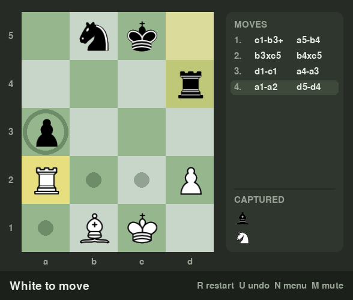

# Micro Chess



Chess on a 4×5 board, with a pygame interface and a computer opponent.

## What is Micro Chess?

Micro Chess is a small chess variant invented by Glimne in 1997. The board is 4 squares wide and
5 high, and each side has only five pieces: a king, a rook, a bishop, a knight and a pawn. Games
are short and sharp, since a single mistake can decide them.

### Starting position

```
    a   b   c   d
  +---+---+---+---+
5 | k | n | b | r |
  +---+---+---+---+
4 | p |   |   |   |
  +---+---+---+---+
3 |   |   |   |   |
  +---+---+---+---+
2 |   |   |   | P |
  +---+---+---+---+
1 | R | B | N | K |
  +---+---+---+---+
```

Uppercase letters are White, lowercase are Black: **K** king, **R** rook, **B** bishop, **N** knight,
**P** pawn. White moves first.

### Rules

The pieces move as in ordinary chess, with these differences:

- **Pawns** move one square at a time (there is no two-square first move, so no en passant).
- **Promotion:** there is no queen, so a pawn that reaches the far rank becomes a rook, bishop or knight.
- **Castling:** the king moves two squares toward its rook and the rook jumps to the square the king
  crossed. For White that is king d1→b1 and rook a1→c1; for Black, king a5→c5 and rook d5→b5. It's
  allowed only if neither the king nor that rook has moved, the squares between them are empty, and
  the king isn't in check and doesn't pass through or land on an attacked square.
- **Draws:** stalemate, threefold repetition, or only the two kings left on the board.

## Features

- A pygame interface: click a piece to see its legal moves, then click where it should go
- Play against the computer as White or Black (the board turns around when you play Black), at
  Easy, Medium or Hard, or play a friend on the same computer
- Highlights for the last move and for a king in check, plus a picker for pawn promotion
- A side panel with the move list and the captured pieces
- Sliding piece animations, and move and capture sounds generated in code (no sound files)
- Undo, restart, and a game-over screen with **Play again**
- The computer thinks in a background thread, so the window never freezes
- A terminal version that needs nothing but Python
- A pytest test suite, including GUI tests that run without opening a window

## Installing and running

You need Python 3 (developed with Python 3.13) and pygame 2.1 or newer.

```bash
git clone https://github.com/nikhilkumar1226/Mirco-Chess.git
cd Mirco-Chess
python3 -m pip install -r requirements.txt
python3 main.py
```

To keep the packages separate from the rest of your system, create a virtual environment first:

```bash
python3 -m venv .venv
source .venv/bin/activate        # on Windows: .venv\Scripts\activate
```

The terminal version doesn't need pygame:

```bash
python3 play_terminal.py
```

## Controls

On the start menu, choose your opponent (**Computer** or **2 Players**), your color and the
difficulty, then click **Start game** or press Enter.

| Action | Control |
| --- | --- |
| Select a piece | Click it: dots mark the squares it can move to, rings mark captures |
| Move | Click one of the marked squares |
| Cancel a selection | Click anywhere else |
| Castle | Move the king two squares (d1→b1 for White, a5→c5 for Black) |
| Promote a pawn | Choose rook, bishop or knight in the picker |
| Undo | **U**: takes back your move and the computer's reply (one move in a 2-player game) |
| Restart | **R** |
| Back to the menu | **N** |
| Sound on/off | **M** |
| Quit | **Esc** |

In the terminal version, type a move as two squares, such as `d2 d3`. To castle, type the king's
move (`d1 b1` or `a5 c5`). Type `quit` to leave.

## How the AI works

The computer uses **minimax search with alpha-beta pruning**. It tries every move, every reply to
it, every answer to that reply and so on, assuming both sides always pick their best option.
Alpha-beta pruning skips lines that can't change the final choice, which makes the search much
faster without changing its result.

**Difficulty is the search depth**, the number of moves (plies) it looks ahead:

| Level | Depth |
| --- | --- |
| Easy | 2 plies |
| Medium | 4 plies |
| Hard | 6 plies |

At the end of each line it scores the position (positive is good for White) by adding up:

- **Material:** pawn 100, knight and bishop 300, rook 500
- **Piece-square tables** for the 4×5 board: knights and bishops prefer the center, pawns gain value
  as they advance, and the king stays tucked in its corner while there are pieces around to attack
  it, then heads for the center in the endgame
- **Mobility:** a small bonus for every square a knight, bishop or rook can move to
- **King safety:** a penalty for every enemy attack on the squares around the king

A few more details:

- Captures and promotions are searched first, which lets alpha-beta prune much more.
- A checkmate scores far above anything else, and a sooner mate scores higher, so it takes the
  quickest win and puts off a loss as long as it can.
- Draws by stalemate, repetition or bare kings score 0.
- When several moves score exactly the same, it picks one of them at random.

Hard usually answers in well under a second.

## Running the tests

```bash
python3 -m pip install -r requirements-dev.txt
python3 -m pytest
```

The GUI and sound tests use SDL's dummy video and audio drivers, so no window opens and nothing plays.

## Project structure

```
Mirco-Chess/
├── main.py               # starts the pygame game
├── gui.py                # pygame interface: menu, board, side panel, animations
├── sounds.py             # move and capture sounds, generated in code
├── play_terminal.py      # the terminal version
├── chess_engine.py       # the rules: moves, castling, promotion, check, checkmate and draws
├── ai.py                 # the computer player: minimax with alpha-beta pruning
├── images/               # piece images (60×60 PNG)
├── docs/screenshot.png   # the screenshot at the top of this page
├── tests/                # pytest tests
├── requirements.txt      # pygame
├── requirements-dev.txt  # pygame and pytest
└── pytest.ini
```

## Image credits

The piece images in `images/` come from: **TODO: add the source, author and license of the piece images.**

## License

MIT. See [LICENSE](LICENSE).
